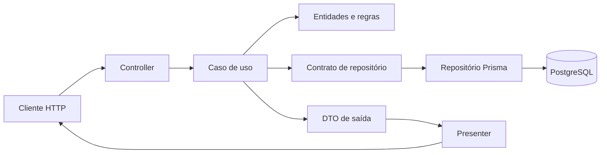

# Arquitetura

## Princípio central

O núcleo da aplicação não conhece NestJS nem Prisma. Domínio e casos de uso
definem o comportamento; a infraestrutura adapta requisições HTTP e operações
do PostgreSQL para esses contratos.



A direção importante é `infrastructure → application → domain`. O domínio não
deve importar camadas externas.

## Organização por recurso

Os recursos `users`, `barberShop`, `services` e `appointments` repetem a mesma
estrutura:

```text
src/<recurso>/
├── domain/
│   ├── entities/       # estado e invariantes
│   ├── value-objects/  # valores com semântica própria
│   ├── validators/     # validação de entidades
│   └── repositories/   # contratos de persistência
├── application/
│   ├── usecases/       # orquestração das regras
│   ├── dto(s)/         # modelos de saída
│   ├── services/       # políticas reutilizadas por casos de uso
│   └── ports/          # contratos externos, como transações
└── infrastructure/
    ├── dto/            # entrada e validação HTTP
    ├── presenters/     # serialização da resposta
    ├── database/prisma # repositórios, mappers e transações
    ├── *.controller.ts
    └── *.module.ts
```

`src/shared` concentra os elementos transversais: entidade base, paginação,
erros, hash de senha, Prisma, configuração, filtros, presenters compartilhados
e o interceptor de resposta.

## Responsabilidade de cada camada

### Domínio

- representa entidades e value objects;
- garante invariantes no construtor e nos métodos de alteração;
- declara contratos de repositório;
- lança erros de domínio, sem conhecer códigos HTTP;
- gera os UUIDs por meio da entidade base.

### Aplicação

- executa uma intenção do usuário em um caso de uso;
- verifica existência, propriedade, papel e transições permitidas;
- combina múltiplos repositórios e serviços de domínio/aplicação;
- retorna DTOs de saída, nunca modelos Prisma;
- delimita operações atômicas por ports quando necessário.

Os casos de uso seguem o padrão de namespace:

```ts
export namespace NomeUseCase {
  export type Input = {};
  export type Output = {};

  export class UseCase implements UseCaseContract<Input, Output> {
    async execute(input: Input): Promise<Output> {
      // regra e orquestração
    }
  }
}
```

### Infraestrutura

- controller: converte HTTP em uma chamada de caso de uso;
- DTO: valida e transforma body ou query string;
- presenter: controla o formato público da resposta;
- repository: implementa o contrato do domínio com Prisma;
- mapper: converte modelo persistido em entidade e vice-versa;
- module: monta a injeção de dependências.

Repositórios são injetados por tokens de string, como
`'AppointmentRepository'`. Casos de uso são registrados usando a própria classe
`UseCase` como token.

## Caminho de uma requisição

Uma criação de agendamento ilustra o fluxo:

1. o `ValidationPipe` transforma `date` e rejeita campos inválidos;
2. o `AuthGuard` valida o JWT, consulta a identidade e o papel atuais no banco
   e coloca `id` e `role` em `request.user`;
3. o controller acrescenta o usuário autenticado como `clientId`;
4. o caso de uso carrega serviço e barbearia;
5. o serviço de disponibilidade verifica expediente, folgas e conflitos;
6. a entidade valida o novo agendamento;
7. o repositório Prisma persiste a entidade;
8. o DTO de saída e o presenter selecionam os campos públicos;
9. o interceptor envolve o resultado em `{ data: ... }`.

## Autenticação e autorização

Há duas barreiras complementares:

- `AuthGuard`: valida `Authorization: Bearer <accessToken>` e resolve a
  identidade e o papel atuais do usuário no banco;
- `RoleGuard`: compara o papel de `request.user`, preenchido pelo `AuthGuard`,
  com `@Roles(...)`.

O guard de papel protege a entrada, mas não substitui as regras do caso de uso.
Propriedade e vínculo continuam sendo conferidos na aplicação, pois dois
usuários com o mesmo papel não possuem acesso aos mesmos recursos.

## Persistência

`PrismaService` é o acesso ao PostgreSQL. `prisma/schema.prisma` descreve o
modelo atual e cada alteração é registrada em uma nova migration.

A criação de uma barbearia é um exemplo de atomicidade: inserir a barbearia,
promover o usuário para `owner` e associá-lo ao estabelecimento acontece em uma
única transação Prisma. Assim, uma falha não deixa o cadastro pela metade.

Para impedir double booking concorrente, além da verificação na aplicação, uma
migration adiciona proteção no PostgreSQL contra intervalos sobrepostos do
mesmo barbeiro.

## Componentes globais

- prefixo HTTP: `/api/v1`;
- servidor: NestJS sobre Fastify;
- validação: `class-validator`, com transformação e rejeição de campos extras;
- serialização: `ClassSerializerInterceptor` e presenters;
- envelope: `WrapperDataInterceptor`;
- documentação: Swagger/OpenAPI gerado a partir de controllers e DTOs;
- CORS: origens configuradas por ambiente;
- erros: filtros globais para os erros já padronizados.

## Fronteiras verificadas automaticamente

`pnpm check:architecture` analisa os arquivos resolvidos por `dependency-cruiser`, usando o alias `@/` do `tsconfig.json`. As regras versionadas ficam em `.dependency-cruiser.cjs`; `pnpm test:architecture` verifica as próprias regras com projetos temporários, sem banco.

| Origem | Código interno permitido | Restrições adicionais |
| --- | --- | --- |
| `src/<recurso>/domain` | Outros arquivos em `src/*/domain`, inclusive `shared/domain` | Não acessa application, infraestrutura, auth ou composição da aplicação. |
| `src/<recurso>/application` | Arquivos em `src/*/domain` e `src/*/application` | Não acessa infraestrutura, auth ou composição da aplicação. |
| Infraestrutura, auth e composição | Podem conectar domínio, aplicação e adaptadores | Continuam sujeitos a proibição de ciclos, imports não resolvidos e dependência de testes. |
| Testes e helpers de testes reconhecidos | Podem exercitar infraestrutura mesmo próximos ao domínio | Essa permissão não se propaga para código de produção que os importe. |

No núcleo (`domain`/`application`), imports de NestJS, Prisma e adaptadores HTTP Fastify/Express são proibidos, inclusive imports só de tipos. Isso não é uma proibição de toda biblioteca externa: `class-validator`, `uuid` e o provider de hash já utilizados continuam permitidos pelas convenções atuais.

`shared` preserva as mesmas fronteiras; `shared/infrastructure` não é permitido no núcleo. Contratos entre recursos continuam permitidos nas camadas apropriadas. Esta entrega não transforma cada recurso em bounded context isolado nem proíbe seus contratos existentes.

O verificador inclui arquivos de testes no grafo para detectar produção importando testes; somente as regras de camada isentam suas origens. São reconhecidos os diretórios `__tests__`, `__mocks__`, `__fixtures__`, `test`, `tests`, `testing` e os sufixos `.spec`, `.test`, `.int-spec`, `.e2e-spec`. Ciclos e imports não resolvidos também são erros. Não há baseline ignorada ou exceção para os ciclos encontrados nesta entrega.

A inspeção inicial encontrou seis ciclos entidade → validator → tipo Props exportado pela entidade. Os tipos foram movidos para arquivos `*.props.ts` no próprio domínio; entidades reexportam os tipos para preservar os caminhos existentes. Validadores importam diretamente o contrato de props, eliminando os ciclos inclusive antes da compilação.

### Testes das regras e limites

As fixtures cobrem imports por alias e relativos, `import type`, reexports/barrels, `import()` com caminho literal, resolução de Express para `@types/express`, shared, ciclos inclusive de tipos, imports não resolvidos e retorno não zero da CLI usada como gate. Exemplos válidos garantem que casos de uso possam importar contratos e que testes de integração possam acessar infraestrutura.

Análise estática não resolve imports cujo caminho é construído em runtime. Também não prova a qualidade da modelagem ou das invariantes; a [revisão focada de agendamentos](revisao-ddd-agendamentos.md) registra essa frente separadamente.

### CI e evidência da entrega

`.github/workflows/backend-ci.yml` roda em pull requests, push para `main` e execução manual, com Node 24, pnpm do `packageManager`, PostgreSQL 15 e env efêmeros. Executa testes das regras, check do código, lint, build e testes unitários/integração/e2e. Suites que limpam `barber_api_test` são sequenciais. Actions estão fixadas por SHA e o job tem acesso de leitura ao conteúdo.

O workflow foi validado localmente com `actionlint`; não foi executado no GitHub nesta entrega. Para bloquear merges, após a primeira execução é necessário configurar esse job como check obrigatório na proteção/ruleset da branch. Adicionar o YAML sozinho não configura a proteção da branch.

Em 18/10/2026: 35 testes de arquitetura aprovados; código real com 235 módulos e 1.187 dependências sem violações; lint/build e 130 unitários + 185 integração + 36 e2e aprovados. Auditoria completa após adicionar a ferramenta: zero alertas reportados. No TDD das regras, a configuração inicialmente sem restrições deixou 24 cenários inválidos passarem; os testes falharam como esperado. A regressão adicional de Express também falhou antes de cobrir a resolução por `@types`. Logs temporários em `/tmp/barber-architecture` registram RED/GREEN e o check inicial que detectou os seis ciclos.
